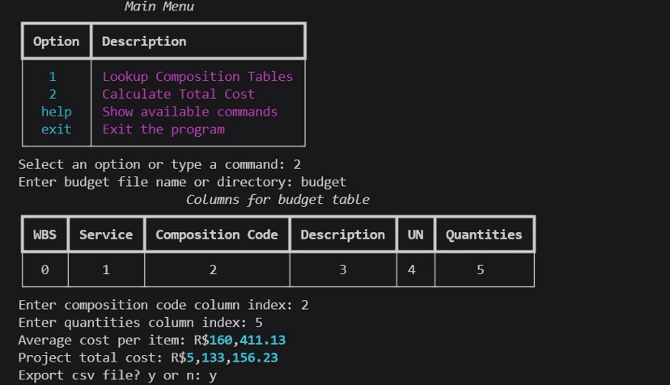

# Budgetpy: Construction Budgeting with SINAPI

A Python command-line tool for estimating construction project costs with SINAPI, Brazil's National System of Costs and Indexes of Construction. Look up unit prices and compositions, download the latest SINAPI table for any state, and price a whole budget spreadsheet in one step.

**Stack:** Python · pandas · rich · requests



## Overview

SINAPI publishes reference costs for construction items every month, per state. Budgetpy turns that table into a quick budgeting tool: find an item, then price an entire project from a CSV of composition codes and quantities.

**Key terms**

| Term | Meaning |
|------|---------|
| **SINAPI** | Brazil's national reference table of construction costs, published monthly by Caixa |
| **Composition** | A construction activity with its unit cost, identified by a code |
| **Desonerado** | The "tax-relief" variant of the table (payroll tax relief applied). SINAPI publishes both versions. |

## Features

- **Lookup:** Search compositions by exact code, or by a sequence of keywords in the description.
- **Table download:** Fetch the latest SINAPI table for any Brazilian state, desonerado or not.
- **Cost calculation:** Provide a budget CSV and Budgetpy joins it to the SINAPI table, computes the total and average cost, and can export a new CSV with the cost of each row.
- **Input detection:** Automatically detects the budget file's encoding and delimiter.
- **Interactive menus:** Styled terminal interface built with `rich`, with `help` and `exit` available everywhere.

## Getting Started

**Prerequisites:** Python 3 and pip.

```bash
git clone https://github.com/lucas-rollin/budgetpy.git
cd budgetpy

python3 -m venv venv
source venv/bin/activate    # On Windows: venv\Scripts\activate

pip install -r requirements.txt
python project.py
```

To skip the download prompt, pass an existing SINAPI file:

```bash
python project.py SINAPI_Custo_Ref_Composicoes_Sintetico_sc_202408_NaoDesonerado.xlsx
```

## Usage

On launch, Budgetpy asks whether to download the latest SINAPI table (`yes` or `no`). If you say yes, it asks for the state and whether you want the desonerado version, then downloads the file. If you say no, or the download fails, it asks for the path to an existing SINAPI table.

> **Download note:** `caixa.gov.br` sometimes blocks automated requests (HTTP 403 or 429). If that happens, download the table manually from the SINAPI website and provide its path.

Once the table is loaded, the main menu offers:

| Command | Action |
|---------|--------|
| `1` | **Lookup:** search the SINAPI table |
| `2` | **Calculate:** price a budget file |
| `help` | Show available commands |
| `exit` | Quit |

### Lookup (`1`)

- **From keywords:** Enter words to search within SINAPI descriptions. Matching codes and descriptions are listed.
- **From exact code:** Enter a composition code. If found, its details are shown in a table.

Type `help` for commands or `exit` to return to the main menu.

### Calculate (`2`)

1. Enter the name or path of your budget CSV.
2. Enter the column indexes for the composition codes and for the quantities.
3. Budgetpy displays the total and average cost of the project.
4. Choose whether to export the results to a new CSV.

## Project Structure

```
cs50p/
├── project.py          # Main application: user interface and logic flow
├── request.py          # Downloads and extracts SINAPI tables
├── budget.py           # Loads and processes the budget CSV
├── test_project.py     # Tests for core functions (pytest)
├── requirements.txt    # Dependencies
└── README.md
```

---

## Technical Reference

### `project.py`

The core of the application: runs the interactive lookup and calculation flows.

| Function | Purpose |
|----------|---------|
| `main()` | Entry point: loads the SINAPI table and displays the main menu |
| `load_sinapi_table()` | Loads the SINAPI table into a pandas DataFrame |
| `filename_add_extension(filename)` | Adds `.xlsx` if the extension is missing |
| `display_main_menu()` | Renders the main menu with `rich` |
| `display_lookup_menu()` | Renders the lookup menu |
| `lookup_composition_table(df)` | Routes lookup commands to keyword or code search |
| `filter(keywords, df)` | Returns rows whose descriptions contain the keywords |
| `lookup_composition_table_keyword(df)` | Prompts for keywords and displays matches |
| `lookup_composition_table_code(df)` | Prompts for an exact code and displays the composition |
| `calculate_total_cost(df)` | Joins the budget to the SINAPI table by code, computes total and average cost, and offers CSV export |
| `get_composition_index(budget_cols)` | Prompts for and validates the composition-code column index |
| `get_quantities_index(budget_cols)` | Prompts for and validates the quantities column index |

### `request.py`

| Function | Purpose |
|----------|---------|
| `download_sinapi_table()` | Downloads and extracts the SINAPI table via HTTP request, based on user input |
| `get_state()` | Prompts for the Brazilian state |
| `get_desonerado()` | Asks whether to use the desonerado version |
| `get_date(month_count=0)` | Returns a `'%Y%m'` string for the table's month. Defaults to the current month; `month_count` steps back to earlier months. |

### `budget.py`

| Function | Purpose |
|----------|---------|
| `detect_encoding_and_separator(csv_filename)` | Detects the encoding and delimiter of the budget CSV so it loads correctly |
| `load_budget_file()` | Prompts for the budget file and returns it as a pandas DataFrame |

### Tests

`test_project.py` uses `pytest` to cover the core logic:

| Test | Verifies |
|------|----------|
| `test_filename_add_extension()` | Extensions are added when missing and left alone when present |
| `test_filter()` | One or more keywords return the expected rows, and no matches return an empty list |
| `test_get_quantities_index_valid()` | Only valid in-range column indexes are accepted for quantities |
| `test_get_composition_index_valid()` | Same validation for the composition-code column |

Install test dependencies

```bash
pip install -r requirements-dev.txt
```

Run tests

```bash
pytest test_project.py       # run the tests
pytest test_project.py -v    # verbose output
```

## About

Final project for [Harvard's CS50P](https://cs50.harvard.edu/python/), Introduction to Programming with Python.